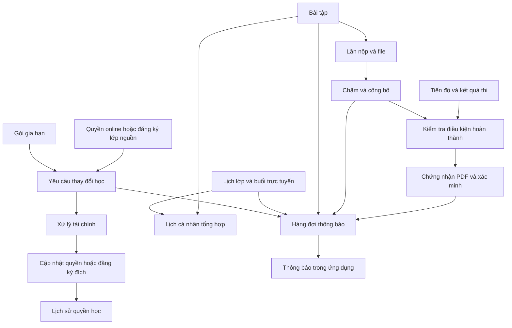

# Đặc tả chức năng mở rộng học trực tuyến

Ngày tổng hợp: 04/11/2026.

Tài liệu bổ sung cho [Đặc tả học trực tuyến](./dac-ta-hoc-truc-tuyen.md), gồm: gia hạn, chuyển hình thức học, chứng nhận hoàn thành, lịch học cá nhân, bài tập có hạn nộp và thông báo trong ứng dụng.

Đây là thiết kế đề xuất, chưa triển khai code hoặc migration. Các chính sách cần quyết định được ghi riêng, không xem là quy định đã có của trung tâm.

## 1. Gia hạn khóa online

### 1.1. Luồng sử dụng

1. Admin cấu hình gói gia hạn theo khóa: số ngày, giá, thời gian áp dụng.
2. Học viên chọn “Gia hạn” tại khóa đã mua, xem giá và thời hạn dự kiến.
3. Học viên gửi yêu cầu, thực hiện thanh toán theo quy trình của hệ thống.
4. Admin/nhân viên có quyền xác nhận hoặc từ chối.
5. Khi xác nhận thanh toán, backend cập nhật thời hạn, ghi lịch sử và thông báo cho học viên.

```text
Còn hạn: ngày hết hạn cũ + số ngày gia hạn
Đã hết hạn: thời điểm kích hoạt gia hạn + số ngày gia hạn
Không giới hạn thời gian: không áp dụng gia hạn
```

### 1.2. Quy tắc

- Giữ nguyên tiến độ, bài nộp và kết quả thi.
- Chụp giá, số ngày và chính sách tại lúc gửi yêu cầu; không tính lại theo gói đã sửa khi duyệt.
- Chỉ gia hạn khi yêu cầu đủ điều kiện và được xác nhận thanh toán.
- Duyệt lặp cùng yêu cầu không cộng thêm ngày hoặc tạo trùng giao dịch.
- Nếu quyền học thay đổi trong thời gian chờ duyệt, tính lại hiệu lực dựa trên quyền thực tế và kiểm tra điều kiện trước khi hoàn tất.
- Quyền bị thu hồi cần quy trình xử lý riêng, không tự mở lại bằng gia hạn.

### 1.3. Chính sách cần chốt

- Có cho mua nhiều gói liên tiếp không?
- Khóa đã ngừng bán có cho gia hạn không?
- Một ngày gia hạn tính đủ 24 giờ hay đến cuối ngày theo giờ Việt Nam?
- Có giới hạn thời gian gửi yêu cầu trước/sau khi hết hạn không?

## 2. Chuyển hình thức học

### 2.1. Luồng sử dụng

1. Học viên chọn đăng ký trực tiếp hoặc quyền online muốn chuyển.
2. Chọn hình thức đích; nếu chuyển sang trực tiếp thì chọn lớp.
3. Nhân viên kiểm tra điều kiện, xác định giá đích, khoản khấu trừ, tiền đóng thêm hoặc hoàn lại.
4. Học viên xem phương án tài chính và xác nhận nếu cần.
5. Hoàn tất thu thêm/hoàn tiền theo chính sách.
6. Backend chuyển quyền/đăng ký, lưu liên kết nguồn–đích, lịch sử và gửi thông báo.

### 2.2. Kiểm tra bắt buộc

- Học viên sở hữu đăng ký/quyền nguồn và đủ điều kiện chuyển.
- Hình thức đích đang được cung cấp; giai đoạn đầu chỉ chuyển trong cùng khóa học.
- Lớp đích thuộc đúng khóa, còn sĩ số, nhận học viên và không trùng lịch.
- Kiểm tra lại lớp và quyền tại lúc hoàn tất, không chỉ lúc tạo yêu cầu.
- Nếu chờ thanh toán, không mặc định giữ chỗ lớp; khi hết chỗ cần phương án đổi lớp hoặc xử lý giao dịch đã thu.
- Chỉ thay đổi quyền khi điều kiện tài chính đã hoàn tất. Trường hợp hoàn tiền bên ngoài cần xác nhận riêng trước khi đánh dấu hoàn tất.
- Không xóa đơn mua, hóa đơn, tiến độ hay kết quả cũ.
- Ghi rõ quyền nguồn kết thúc, được giữ lại hay chuyển sang trạng thái nào; không tự giả định được học cả hai hình thức.
- Không tính khoản khấu trừ chỉ bằng chênh lệch giá niêm yết; dựa trên số đã thanh toán và chính sách được duyệt.

### 2.3. Chính sách cần chốt

- Thời hạn cho phép chuyển và giới hạn số lần chuyển.
- Tỷ lệ nội dung đã học hoặc số buổi đã tham gia tối đa.
- Phí chuyển, khoản khấu trừ và điều kiện hoàn tiền.
- Khi online → trực tiếp, có giữ quyền online không?
- Khi trực tiếp → online, ngày bắt đầu và thời hạn online tính thế nào?
- Phương án xử lý khi thanh toán thành công nhưng lớp đích không còn phù hợp.

## 3. Chứng nhận hoàn thành

### 3.1. Điều kiện và luồng cấp

Admin cấu hình điều kiện cho từng khóa, ví dụ:

- Hoàn thành các bài học bắt buộc.
- Nộp đủ và đạt yêu cầu các bài tập bắt buộc.
- Đạt điểm tối thiểu bài thi cuối khóa.
- Có xác nhận của giảng viên nếu khóa yêu cầu đánh giá thực hành.

Luồng: học viên đạt điều kiện → hệ thống xác định đủ điều kiện → admin/giảng viên có quyền duyệt cấp → tạo chứng nhận PDF → gửi thông báo → học viên tải về.

### 3.2. Nội dung chứng nhận

- Tên trung tâm, tên học viên, tên khóa học và hình thức học.
- Ngày cấp, mã chứng nhận duy nhất.
- QR/liên kết xác minh, người cấp và mẫu trình bày.
- Kết quả hoặc thời lượng học nếu trung tâm có quy định.

### 3.3. Quy tắc

- Lưu phiên bản điều kiện và thông tin học viên/khóa tại thời điểm cấp.
- Sửa tên khóa hoặc hồ sơ không tự thay đổi chứng nhận đã cấp; đính chính/cấp lại phải có lịch sử.
- Mỗi lần cấp hợp lệ có mã duy nhất; chống cấp trùng cùng lượt hoàn thành.
- Trang xác minh chỉ công khai thông tin cần thiết, thể hiện được trạng thái thu hồi.
- Chứng nhận là chứng nhận hoàn thành do trung tâm cấp, không tương đương chứng chỉ IELTS/TOEIC.
- Nếu điều kiện hoàn thành thay đổi, cần quy định áp dụng phiên bản nào cho học viên đã mua trước đó.
- Đánh dấu đã xem video không tự chứng minh đã thành thạo; nên kết hợp bài tập và đánh giá.

## 4. Lịch học cá nhân

### 4.1. Nguồn sự kiện

| Nguồn | Sự kiện hiển thị |
|---|---|
| Đăng ký lớp và buổi học trực tiếp | Ngày giờ, lớp, phòng và giảng viên |
| Buổi học trực tuyến | Ngày giờ, nền tảng và nút mở phòng |
| Bài tập online | Hạn nộp, trạng thái bài nộp |
| Đề thi có lịch mở/đóng | Thời gian được phép bắt đầu/làm bài |

### 4.2. Giao diện và nghiệp vụ

- Chế độ ngày/tuần/tháng hoặc danh sách sắp tới.
- Lọc theo khóa học và loại hoạt động.
- Bấm sự kiện để mở bài tập, chi tiết lớp hoặc phòng trực tuyến.
- Đánh dấu lịch bị hủy, bài đã nộp và các sự kiện trùng giờ.
- Hiển thị theo `Asia/Ho_Chi_Minh`; backend lưu thời gian theo quy ước thống nhất.
- Học viên chỉ xem sự kiện của mình; giảng viên có lịch dạy và hạn chấm liên quan nếu triển khai.

### 4.3. Thiết kế dữ liệu

Không tạo bảng bản sao toàn bộ lịch. API tổng hợp dữ liệu nguồn theo khoảng ngày và quyền truy cập, trả về cấu trúc chung gồm loại sự kiện, mã nguồn, tiêu đề, thời gian, trạng thái và liên kết điều hướng.

Khi sửa/hủy lịch nguồn, lịch cá nhân phản ánh cập nhật khi tải lại. Với sự kiện lặp, cần dùng ngày học thực tế và các ngoại lệ nghỉ/bù thay vì chỉ hiển thị khung giờ tuần.

Chỉ thêm `su_kien_ca_nhan` nếu cho người dùng tự tạo nhắc việc; chưa bắt buộc trong phạm vi này. Nếu hỗ trợ lịch thi, bổ sung giờ mở/đóng vào `de_thi_online` và phân biệt với thời lượng mỗi lượt thi.

## 5. Bài tập có hạn nộp

### 5.1. Giảng viên

- Tạo bài tập cấp khóa hoặc gắn một bài học.
- Nhập đề, tài liệu, kiểu trả lời, thời điểm mở và hạn nộp.
- Cấu hình số lần nộp, cho nộp muộn, hạn nộp muộn, điểm tối đa và tiêu chí chấm.
- Đánh dấu bắt buộc nếu dùng làm điều kiện hoàn thành.
- Xem bài nộp, chấm điểm, nhận xét và yêu cầu sửa.

### 5.2. Học viên

- Xem bài tập và thời hạn.
- Lưu nháp văn bản, đính kèm tài liệu hoặc ghi âm/upload âm thanh.
- Nộp bài, xem trạng thái đúng hạn/muộn.
- Xem điểm, nhận xét và nộp phiên bản sửa khi được phép.

### 5.3. Quy tắc

- Backend kiểm tra thời gian server, quyền học, kiểu/dung lượng file và số lần nộp.
- Bài nộp đã gửi không bị sửa trực tiếp; lần nộp mới giữ lịch sử bản trước.
- Phân biệt “chưa nộp”, “đã nộp”, “cần sửa” và “đã chấm”; nộp muộn là thuộc tính riêng.
- Quy định rõ lấy điểm lần cuối, cao nhất hay do giảng viên chọn. Đề xuất ban đầu lấy lần cuối được chấp nhận, không mặc định áp dụng trước khi chốt.
- Đổi hạn nộp phải thông báo và giữ dấu vết thay đổi.
- File bài nộp chỉ học viên sở hữu và người có quyền chấm/quản lý được xem.
- Bài tập có thể cho sửa/nộp lại; thi thử tiếp tục dùng thời gian làm bài, lượt thi và cơ chế công bố đáp án riêng.

## 6. Thông báo trong ứng dụng

### 6.1. Giao diện

- Biểu tượng chuông và số thông báo chưa đọc.
- Danh sách theo thời gian, lọc chưa đọc và đánh dấu đã đọc.
- Nội dung ngắn gọn, thời điểm tạo và liên kết tới màn hình liên quan.
- Bấm thông báo vẫn kiểm tra quyền hiện tại; thông báo cũ không cấp quyền truy cập.

### 6.2. Sự kiện phát thông báo

| Sự kiện | Người nhận |
|---|---|
| Yêu cầu mua/gia hạn/chuyển được xử lý | Học viên gửi yêu cầu |
| Có yêu cầu cần duyệt | Admin/nhân viên có quyền |
| Bài tập mới, đổi hạn hoặc sắp đến hạn | Học viên thuộc khóa, theo trạng thái nộp |
| Có bài nộp cần chấm | Giảng viên phụ trách |
| Bài đã được chấm/công bố kết quả | Học viên liên quan |
| Tạo/đổi/hủy lịch trực tuyến | Học viên có quyền thuộc khóa |
| Sắp bắt đầu buổi học | Học viên/giảng viên liên quan |
| Quyền học sắp hết hạn | Học viên có quyền đó |
| Chứng nhận được cấp/thu hồi | Học viên liên quan |

### 6.3. Cách triển khai

- Giai đoạn đầu tải thông báo khi mở ứng dụng và kiểm tra định kỳ lúc ứng dụng hoạt động.
- Nhắc lịch/hạn nộp dùng tác vụ chạy nền; không phụ thuộc việc người dùng đang mở ứng dụng.
- Ghi tác vụ gửi thông báo cùng transaction với thay đổi nghiệp vụ để tránh dữ liệu đã lưu nhưng không tạo thông báo.
- Tác vụ có khóa chống trùng và cơ chế thử lại; xử lý lặp không gửi nhiều lần cùng một thông báo.
- Đổi/hủy lịch phải vô hiệu hóa nhắc cũ. Khi gửi, kiểm tra lại phiên bản lịch, quyền người nhận và trạng thái đã nộp bài nếu liên quan.
- Thông báo trong ứng dụng chỉ hiện khi người dùng truy cập ứng dụng; push notification và email là kênh mở rộng riêng.
- Có thể bổ sung realtime sau nếu cần cập nhật tức thì.

## 7. Các bảng mới đề xuất

Các bảng sau bổ sung cho 13 bảng ở tài liệu nền. PK là khóa chính, FK là khóa ngoại. Tên trường và kiểu dữ liệu sẽ chốt khi viết migration.

### 7.1. `goi_gia_han_online`

- `ma_goi` (PK), `ma_khoa_hoc` (FK).
- `ten_goi`, `so_ngay`, `gia`, `trang_thai`.
- `ap_dung_tu`, `ap_dung_den`, `ngay_tao`, `ngay_cap_nhat`.
- Giá không âm, số ngày dương; thời gian áp dụng hợp lệ.

### 7.2. `yeu_cau_thay_doi_hoc`

- `ma_yeu_cau_thay_doi` (PK), `ma_hoc_vien` (FK).
- `loai_yeu_cau` (gia hạn/chuyển hình thức).
- `ma_quyen_nguon` (FK, NULL nếu nguồn là đăng ký trực tiếp).
- `ma_dang_ky_nguon` (FK, NULL nếu nguồn là quyền online).
- `ma_goi_gia_han` (FK, tùy loại yêu cầu), `so_ngay_gia_han` đã chụp.
- `hinh_thuc_dich`, `ma_lop_dich` (FK, chỉ dùng khi chuyển sang trực tiếp).
- `gia_dich`, `so_tien_khau_tru`, `so_tien_thu_them`, `so_tien_hoan`, `chinh_sach_ap_dung`.
- `trang_thai` (chờ duyệt/chờ tài chính/hoàn tất/từ chối/đã hủy).
- `ly_do`, `ghi_chu_xu_ly`, `ma_nguoi_duyet` (FK → `nguoi_dung`), các mốc tạo/duyệt/hoàn tất.
- Tham chiếu quyền/đăng ký đích được tạo khi chuyển thành công.
- Đúng một nguồn hợp lệ; nguồn phải thuộc học viên. Duyệt/giao dịch lặp không được thực hiện thay đổi hai lần.

### 7.3. `lich_su_quyen_hoc`

- `ma_lich_su` (PK), `ma_hoc_vien` (FK), `ma_khoa_hoc` (FK).
- `ma_yeu_cau_thay_doi` (FK, NULL cho thao tác quản trị khác).
- `ma_quyen_hoc` (FK, NULL nếu thao tác chỉ liên quan đăng ký lớp), `ma_dang_ky` (FK, tùy trường hợp).
- `loai_thay_doi`, `du_lieu_truoc`, `du_lieu_sau`, `hieu_luc_luc`.
- `ly_do`, `ma_nguoi_thuc_hien` (FK), `ngay_tao`.
- Dữ liệu trước/sau có thể là JSON; đây là lịch sử kiểm toán, không thay thế các bảng nghiệp vụ chính.

### 7.4. `dieu_kien_hoan_thanh`

- `ma_dieu_kien` (PK), `ma_khoa_hoc` (FK), `phien_ban`.
- `ty_le_hoan_thanh_bat_buoc`, `yeu_cau_bai_tap`, `ma_de_thi_cuoi_khoa` (FK, tùy chọn), `diem_toi_thieu`.
- `can_giang_vien_xac_nhan`, `ap_dung_tu`, `ngay_tao`.
- UNIQUE (`ma_khoa_hoc`, `phien_ban`); điều kiện phức tạp hơn có thể tách bảng chi tiết sau.

### 7.5. `chung_nhan_hoan_thanh`

- `ma_chung_nhan` (PK), `ma_xac_minh` (UNIQUE, khó đoán).
- `ma_hoc_vien` (FK), `ma_khoa_hoc` (FK), `ma_dieu_kien` (FK).
- `ma_quyen_hoc` hoặc `ma_dang_ky` xác định lượt học được chứng nhận.
- `ten_hoc_vien_luc_cap`, `ten_khoa_luc_cap`, `hinh_thuc_hoc_luc_cap`, `ket_qua_luc_cap`.
- `ngay_cap`, `ma_nguoi_cap` (FK), `khoa_luu_tru_pdf`.
- `trang_thai` (đang hiệu lực/thu hồi/được thay thế), `ly_do_thu_hoi`, `thu_hoi_luc`, `ma_chung_nhan_thay_the` (FK, tùy chọn).
- Chống cấp trùng chứng nhận hiệu lực cho cùng lượt hoàn thành; giữ lịch sử cấp lại.

### 7.6. `bai_tap_online`

- `ma_bai_tap` (PK), `ma_khoa_hoc` (FK), `ma_bai_hoc` (FK, tùy chọn).
- `tieu_de`, `noi_dung`, `loai_bai_nop`, `diem_toi_da`, `tieu_chi_cham`.
- `mo_luc`, `han_nop`, `cho_nop_muon`, `han_nop_muon`, `so_lan_nop_toi_da`.
- `bat_buoc_hoan_thanh`, `trang_thai`, `ma_nguoi_tao` (FK), ngày tạo/cập nhật.
- Bài học liên quan phải thuộc đúng khóa; các mốc thời gian và điểm phải hợp lệ.

### 7.7. `lan_nop_bai_tap`

- `ma_lan_nop` (PK), `ma_bai_tap` (FK), `ma_hoc_vien` (FK), `lan_nop`.
- `noi_dung_tra_loi`, `trang_thai`, `nop_luc`, `nop_muon`.
- `diem`, `nhan_xet`, `ma_nguoi_cham` (FK), `cham_luc`, `cong_bo_luc`.
- `ngay_tao`, `ngay_cap_nhat` để lưu nháp trước khi nộp.
- UNIQUE (`ma_bai_tap`, `ma_hoc_vien`, `lan_nop`); chống nộp lặp bằng khóa yêu cầu hoặc chuyển trạng thái có điều kiện.

### 7.8. `tep_bai_tap`

- `ma_lien_ket` (PK), `ma_tep` (FK → kho metadata file dùng chung).
- `ma_bai_tap` (FK, với file đề) hoặc `ma_lan_nop` (FK, với file học viên nộp).
- `vai_tro_tep`, `thu_tu`, `ngay_tao`.
- Đúng một đối tượng sở hữu; không sao chép metadata/file vật lý chỉ để liên kết.

### 7.9. `thong_bao`

- `ma_thong_bao` (PK), `loai_su_kien`, `tieu_de`, `noi_dung`.
- `loai_doi_tuong`, `ma_doi_tuong`, `du_lieu_dieu_huong`, `ngay_tao`.
- Không đưa mật khẩu phòng, đáp án hoặc nội dung nhạy cảm vào thông báo chung.

### 7.10. `nguoi_nhan_thong_bao`

- `ma_thong_bao` (FK), `ma_nguoi_dung` (FK), `da_doc_luc` (NULL nếu chưa đọc).
- PK (`ma_thong_bao`, `ma_nguoi_dung`).
- Index theo người nhận để tải danh sách và đếm chưa đọc.

### 7.11. `hang_doi_thong_bao`

- `ma_tac_vu` (PK), `khoa_chong_trung` (UNIQUE).
- `loai_su_kien`, đối tượng nguồn, `phien_ban_nguon`, dữ liệu xử lý và phạm vi người nhận.
- `gui_luc`, `trang_thai`, `so_lan_thu`, `thu_lai_luc`, `loi_cuoi`, `khoa_xu_ly_luc`, `ngay_tao`.
- Worker nhận tác vụ an toàn, kiểm tra lại nguồn rồi tạo thông báo và người nhận; có thử lại và chống xử lý trùng.

## 8. Các bảng/thiết kế hiện có cần điều chỉnh

| Thành phần | Điều chỉnh |
|---|---|
| `quyen_hoc_online` | Cập nhật thời hạn có lịch sử; có thể liên kết phiên bản điều kiện hoàn thành áp dụng |
| `dang_ky_hoc` | Quy định trạng thái khi chuyển hình thức; không xóa đăng ký cũ, cập nhật sĩ số theo trạng thái |
| `hoa_don`, `thanh_toan` | Hỗ trợ tham chiếu yêu cầu gia hạn/chuyển, loại doanh thu và báo cáo tương ứng |
| Hoàn tiền | Nếu chưa có cơ chế, cần thiết kế bảng giao dịch hoàn tiền liên kết thanh toán gốc, trạng thái, số tiền, mã giao dịch và người xác nhận |
| Metadata file | Mở rộng `tep_hoc_online` để dùng chung cho file bài tập và bài nộp, hoặc đổi thành bảng file chung khi triển khai; bổ sung loại file phù hợp |
| `bai_hoc_online` | Bổ sung cờ bài bắt buộc nếu điều kiện chứng nhận dựa vào tập bài bắt buộc |
| `de_thi_online` | Thêm giờ mở/đóng nếu muốn xuất hiện như lịch thi; giữ nguyên thời lượng riêng của lượt thi |
| Lịch trực tiếp/trực tuyến | API lịch tổng hợp; đổi/hủy sự kiện cập nhật hàng đợi nhắc lịch |

`su_kien_ca_nhan` chỉ là bảng tùy chọn nếu cho tự tạo nhắc việc. Bảng hoàn tiền cần khảo sát hệ thống tài chính hiện tại trước khi chốt, nên chưa tính vào 11 bảng cốt lõi ở mục 7.

## 9. Quan hệ nghiệp vụ



## 10. Lộ trình triển khai

Triển khai sau khi luồng mua online, quyền học và nội dung cơ bản hoạt động ổn định.

| Thứ tự | Chức năng | Kết quả cần đạt |
|---|---|---|
| 1 | Bài tập có hạn nộp | Giao bài, lưu nháp, nộp file, chấm, nhận xét và nộp lại |
| 2 | Lịch học cá nhân | Tổng hợp lịch trực tiếp, online và hạn bài tập theo đúng người dùng |
| 3 | Thông báo trong ứng dụng | Hộp thông báo, trạng thái đọc, nhắc lịch chạy nền và chống trùng |
| 4 | Gia hạn | Gói gia hạn, thanh toán, cộng hạn an toàn và giữ lịch sử |
| 5 | Chứng nhận | Điều kiện có phiên bản, duyệt cấp, PDF và xác minh |
| 6 | Chuyển hình thức | Chính sách tài chính, kiểm tra lớp và chuyển quyền có kiểm soát |

## 11. Kiểm tra nghiệm thu trọng tâm

- Học viên không đọc/sửa được bài nộp, yêu cầu hoặc thông báo của người khác.
- Giảng viên ngoài khóa không giao/chấm bài hoặc cấp chứng nhận trái quyền.
- Gia hạn còn hạn/đã hết hạn tính đúng; xác nhận lặp không cộng ngày lần hai.
- Chuyển sang trực tiếp kiểm tra lại sĩ số, lịch; chuyển thất bại không làm mất quyền nguồn.
- Thu thêm và hoàn tiền có lịch sử và trạng thái riêng; không báo hoàn tất tài chính khi mới gửi yêu cầu.
- Bài nộp phân biệt đúng nháp/nộp, đúng hạn/muộn; không mất phiên bản cũ.
- Chứng nhận chỉ cấp khi đủ điều kiện theo phiên bản áp dụng, trang xác minh thể hiện đúng trạng thái.
- Lịch đổi/hủy không tiếp tục gửi nhắc cũ; tác vụ thử lại không tạo thông báo trùng.
- API lịch và liên kết từ thông báo kiểm tra quyền tại thời điểm truy cập.

## 12. Tổng hợp

- Bổ sung thiết kế **6 nhóm chức năng** và **11 bảng mới cốt lõi đề xuất**.
- Không cần bảng lịch bản sao; tổng hợp từ dữ liệu nguồn.
- Dùng chung file, tài chính, tài khoản và quyền học với hệ thống hiện tại.
- Bảng hoàn tiền và sự kiện cá nhân là phần cần khảo sát/chọn phạm vi riêng.
- Các chính sách gia hạn, chuyển hình thức, chấm bài và chứng nhận cần chốt trước khi lập trình nghiệp vụ tương ứng.
