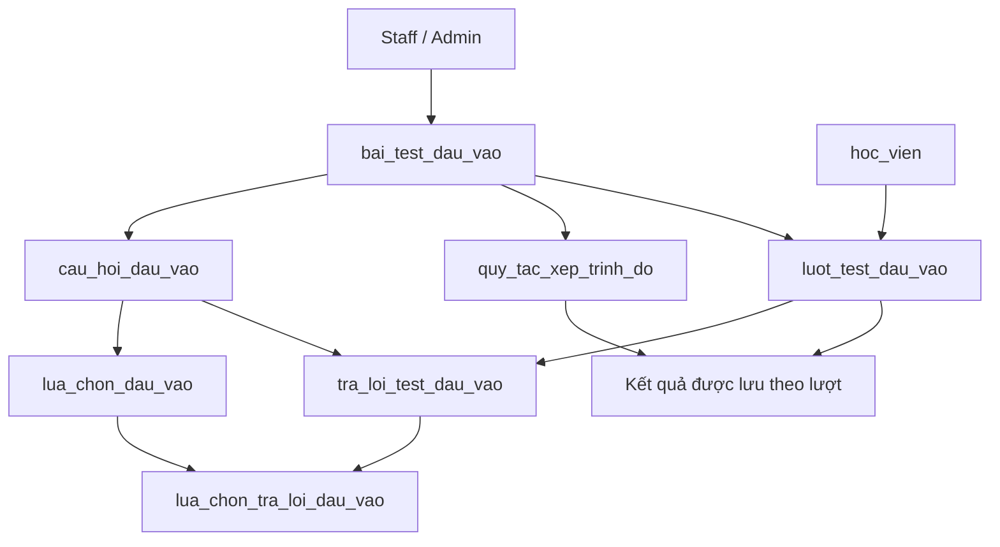

# Đặc tả học thử và kiểm tra trình độ đầu vào

Ngày tổng hợp: 04/11/2026.

Tài liệu bổ sung cho [Đặc tả học trực tuyến](./dac-ta-hoc-truc-tuyen.md). Phạm vi hiện tại kết thúc ở kết quả kiểm tra của học viên; chưa triển khai AI đề xuất khóa học hoặc lộ trình. Đây là thiết kế, chưa thay đổi code hay database.

## 1. Phạm vi

- Học thử các bài học và tài liệu được công khai.
- Staff tạo, cấu hình và xuất bản bài kiểm tra đầu vào.
- Học viên làm bài mà không cần mua khóa học.
- Backend chấm điểm theo đáp án và quy tắc đã cấu hình.
- Hiển thị tổng điểm, điểm từng kỹ năng, mức trình độ tham khảo và nhận xét mẫu.
- Lưu lịch sử làm bài để học viên và staff được phân quyền xem lại.
- Chưa có AI, tư vấn mua khóa hoặc lộ trình học tự động.

## 2. Chức năng học thử

### 2.1. Luồng học viên

```text
Xem chi tiết khóa học
    → Xem danh sách chương/bài
    → Chọn bài có nhãn Học thử
    → Xem video, nội dung và tài liệu được phép
    → Có thể làm kiểm tra đầu vào hoặc xem thông tin mua khóa
```

- Người chưa đăng nhập được xem video và nội dung học thử công khai.
- Muốn lưu tiến độ hoặc làm bài kiểm tra đầu vào thì đăng nhập.
- Bài trả phí chỉ hiển thị tiêu đề/thông tin giới thiệu và biểu tượng khóa.
- Một bài học thử không tự mở miễn phí tất cả tài liệu đính kèm.
- Không mở link Zoom/Meet, bài tập cần giảng viên chấm, đề thi trả phí hoặc chứng nhận chỉ nhờ quyền học thử.
- Có thể bắt đầu bằng 2–3 bài video và một tài liệu mẫu mỗi khóa; số lượng là cấu hình nội dung, không phải giới hạn cứng.

### 2.2. Quản lý nội dung

- Giảng viên đề xuất bài được học thử; admin duyệt hoặc điều chỉnh trước khi công khai.
- Bài chỉ được học thử khi đã xuất bản, chương được hiển thị và khóa được phép công khai.
- Tắt học thử chặn các lượt truy cập tiếp theo; file đã tải xuống không thể thu hồi.
- Backend kiểm tra quyền riêng cho từng bài và từng file, không chỉ ẩn nút trên giao diện.
- Khi học viên mua khóa sau đó, giữ tiến độ đã lưu lúc học thử.

### 2.3. Dữ liệu

| Bảng hiện có trong thiết kế online | Bổ sung |
|---|---|
| `bai_hoc_online` | `cho_hoc_thu` để xác định bài được xem miễn phí |
| `tep_hoc_online` | `mien_phi_hoc_thu` để xác định file được truy cập miễn phí; vẫn xét `cho_phep_tai` |
| `tien_do_hoc_online` | Dùng lại cho người đã đăng nhập, kể cả chưa mua |

Không cần bảng đăng ký học thử riêng ở phạm vi hiện tại. Không bắt buộc mở thi thử trả phí cho người học thử; kiểm tra đầu vào là chức năng độc lập.

## 3. Kiểm tra trình độ đầu vào

### 3.1. Luồng tổng thể

```text
Staff tạo đề, câu hỏi, đáp án và quy tắc xếp trình độ
    → Kiểm tra cấu hình và xuất bản phiên bản đề
    → Học viên đăng nhập, xem hướng dẫn
    → Bắt đầu lượt làm bài
    → Lưu nháp câu trả lời
    → Nộp bài hoặc hết giờ
    → Backend chấm và lưu kết quả
    → Học viên xem kết quả, lịch sử
```

Học thử và kiểm tra đầu vào không bắt buộc diễn ra theo một thứ tự. Học viên có thể làm kiểm tra trước hoặc sau khi học thử.

### 3.2. Staff

- Tạo tên đề, mô tả, hướng dẫn, đối tượng và thời gian làm bài.
- Cấu hình số lượt làm, thời điểm được làm lại và quy định xem đáp án.
- Nhập câu hỏi, lựa chọn, đáp án đúng, điểm và giải thích.
- Gắn kỹ năng cho từng câu: ngữ pháp, từ vựng, đọc hoặc nghe.
- Đính kèm đoạn đọc/file nghe nếu có.
- Cấu hình ngưỡng tổng điểm, điều kiện điểm kỹ năng nếu cần, tên mức trình độ và nhận xét mẫu.
- Xem trước đề và kiểm tra tính hợp lệ trước khi xuất bản.
- Xem kết quả, câu trả lời và lịch sử của học viên theo phân quyền.
- Admin có thể quản lý nội dung tương ứng.

### 3.3. Học viên

- Không cần mua khóa, nhưng phải đăng nhập để làm bài và lưu lịch sử.
- Xem thời gian, số câu, kỹ năng được đánh giá, số lượt làm và hướng dẫn.
- Bắt đầu bài, trả lời, chuyển câu, lưu nháp và nộp bài.
- Xem kết quả và lịch sử của bản thân.
- Xem đáp án/lời giải khi cấu hình đề cho phép.

### 3.4. Loại câu hỏi trong giai đoạn đầu

| Loại | Cách làm | Cách chấm |
|---|---|---|
| Một đáp án | Chọn một lựa chọn | Đúng nhận điểm, sai/bỏ trống nhận 0 |
| Nhiều đáp án | Chọn nhiều lựa chọn | Đề xuất chọn đúng toàn bộ mới nhận điểm; chốt quy tắc trước khi triển khai |
| Đọc hiểu | Đọc đoạn văn rồi chọn đáp án | Theo đáp án cấu hình |
| Nghe hiểu | Nghe âm thanh rồi chọn đáp án | Theo đáp án cấu hình |

Giai đoạn này chưa đánh giá nói và viết tự luận. Kết quả phải ghi rõ kỹ năng chưa được đánh giá. Nếu bổ sung sau, cần luồng chờ chấm và kết quả tạm thời trước khi trả kết quả đầy đủ.

## 4. Chấm điểm và đầu ra

### 4.1. Cách tính

- Backend lấy đáp án, điểm tối đa và quy tắc từ đúng phiên bản đề của lượt làm.
- Tổng điểm bằng tổng điểm câu hỏi đạt được.
- Điểm phần trăm từng kỹ năng bằng điểm đạt được của kỹ năng / tổng điểm tối đa của kỹ năng × 100.
- Kỹ năng không có câu hỏi hiển thị “Chưa đánh giá”, không hiển thị 0%.
- Mức trình độ và nhận xét được chọn bằng quy tắc staff cấu hình, không do AI sinh.
- Ngưỡng xếp mức phải không mâu thuẫn; cần quy định biên rõ ràng và có kết quả cho mọi mức điểm hợp lệ.
- Không khẳng định tương đương IELTS/TOEIC/CEFR khi đề và quy tắc chưa được kiểm chứng cho mục đích đó.

### 4.2. Màn hình kết quả

| Thông tin | Ví dụ minh họa |
|---|---|
| Đề và phiên bản | Kiểm tra nền tảng tiếng Anh – phiên bản 1 |
| Tổng điểm | 58/100 |
| Ngữ pháp | 70% |
| Từ vựng | 60% |
| Đọc | 55% |
| Nghe | 40% |
| Mức trình độ | Cơ bản — mức nội bộ theo ngưỡng cấu hình |
| Nhận xét mẫu | Cần củng cố kỹ năng nghe và vốn từ |
| Chưa đánh giá | Nói, viết |
| Thời điểm nộp | Ngày giờ theo giờ Việt Nam |

Các điểm ví dụ không phải cấu hình chấm thực tế. Giao diện chưa hiển thị đề xuất khóa hoặc lộ trình AI.

### 4.3. Lịch sử

- Lưu riêng từng lượt, không ghi đè kết quả cũ khi làm lại.
- Hiển thị đề, phiên bản, thời điểm làm, tổng điểm và mức tham khảo.
- Giữ kết quả đã tính cùng phiên bản quy tắc; staff sửa đề không làm thay đổi điểm quá khứ.
- Khi so sánh các lần làm, ghi rõ phiên bản đề vì các đề khác nhau chưa chắc có độ khó tương đương.

## 5. Bảy bảng mới đề xuất

Các bảng này dành riêng cho kiểm tra đầu vào, không bắt buộc có quyền mua khóa như thi thử trong khóa. Có thể dùng chung bộ xử lý chấm điểm, upload và xác thực với các module khác.

### 5.1. `bai_test_dau_vao`

- `ma_bai_test` (PK).
- `ma_nhom_de` để liên kết các phiên bản cùng một bài kiểm tra.
- `ten_bai_test`, `mo_ta`, `huong_dan`, `doi_tuong`.
- `phien_ban`, `thoi_gian_phut`, `so_luot_toi_da`, `thoi_gian_cho_lam_lai_phut`.
- `quy_dinh_xem_dap_an`, `trang_thai` (nháp/đã xuất bản/ngừng nhận lượt mới).
- `ma_nguoi_tao` (FK → `nguoi_dung`), `ngay_tao`, `ngay_xuat_ban`.
- UNIQUE (`ma_nhom_de`, `phien_ban`).
- Đề đã xuất bản và được sử dụng không sửa trực tiếp câu hỏi/đáp án/quy tắc; tạo phiên bản mới. Việc dừng nhận lượt mới không mặc định hủy lượt đang làm.

### 5.2. `cau_hoi_dau_vao`

- `ma_cau_hoi` (PK), `ma_bai_test` (FK).
- `loai_cau_hoi`, `ky_nang`, `nhom_kien_thuc` (tùy chọn).
- `noi_dung`, `doan_doc`, `ma_tep_nghe` (FK → metadata file dùng chung, tùy chọn).
- `diem_toi_da`, `thu_tu`, `giai_thich`.
- Điểm phải dương; file nghe chỉ được truy cập theo quyền của lượt làm bài hoặc vai trò quản lý.

### 5.3. `lua_chon_dau_vao`

- `ma_lua_chon` (PK), `ma_cau_hoi` (FK).
- `noi_dung`, `la_dap_an_dung`, `thu_tu`.
- Câu một đáp án có đúng một lựa chọn đúng; câu nhiều đáp án có tập đáp án hợp lệ.

### 5.4. `quy_tac_xep_trinh_do`

- `ma_quy_tac` (PK), `ma_bai_test` (FK).
- `ten_muc`, `diem_phan_tram_tu`, `diem_phan_tram_den`.
- `dieu_kien_ky_nang` (JSON tùy chọn nếu yêu cầu ngưỡng từng kỹ năng).
- `nhan_xet_mau`, `thu_tu_xet`.
- Quy định rõ cách xét các biên và xử lý điều kiện kỹ năng. Nếu chưa cần quy tắc phức tạp, chỉ dùng khoảng tổng điểm không chồng lấn và bao phủ 0–100%.
- Nhận xét chung được lưu tại đây; nếu cần nhận xét riêng theo kỹ năng, có thể bổ sung cấu hình nhận xét kỹ năng sau.

### 5.5. `luot_test_dau_vao`

- `ma_luot_test` (PK), `ma_bai_test` (FK), `ma_hoc_vien` (FK).
- `lan_lam`, `bat_dau_luc`, `han_nop_luc`, `nop_luc`.
- `trang_thai` (đang làm/đã nộp/đã chấm), `ly_do_nop` (chủ động/hết giờ).
- `tong_diem`, `tong_diem_toi_da`, `ket_qua_ky_nang` (JSON).
- `ma_quy_tac` (FK, nếu xếp được mức), `ten_muc_luc_cham`, `nhan_xet_luc_cham`, `cham_luc`.
- UNIQUE (`ma_bai_test`, `ma_hoc_vien`, `lan_lam`).
- Kiểm tra số lượt trong phạm vi `ma_nhom_de` nếu đổi phiên bản không được phép làm mới hạn mức. Chốt phạm vi tính lượt trước khi triển khai.

### 5.6. `tra_loi_test_dau_vao`

- `ma_tra_loi` (PK), `ma_luot_test` (FK), `ma_cau_hoi` (FK).
- `diem_dat`, `cap_nhat_luc`.
- UNIQUE (`ma_luot_test`, `ma_cau_hoi`).
- Chỉ nhận câu hỏi thuộc đúng phiên bản đề của lượt làm.
- Bảng lưu điểm do backend tính, không nhận điểm từ client.

### 5.7. `lua_chon_tra_loi_dau_vao`

- `ma_tra_loi` (FK → `tra_loi_test_dau_vao`).
- `ma_lua_chon` (FK → `lua_chon_dau_vao`).
- PK (`ma_tra_loi`, `ma_lua_chon`).
- Lựa chọn phải thuộc đúng câu hỏi; câu một đáp án không nhận nhiều lựa chọn.

## 6. Quan hệ dữ liệu



## 7. API và quy tắc backend

Các nhóm API cần có:

- Staff: quản lý đề nháp, câu hỏi, lựa chọn, quy tắc; xuất bản; xem lượt và kết quả.
- Học viên: xem đề đang mở, bắt đầu/tiếp tục lượt, lưu câu trả lời, nộp, xem kết quả và lịch sử cá nhân.
- Công khai: danh sách bài học thử và nội dung/file miễn phí được phép truy cập.

Quy tắc bắt buộc:

- Lấy danh tính và vai trò từ JWT, không dùng mã học viên client gửi làm căn cứ sở hữu.
- API làm bài không trả đáp án đúng, lời giải hoặc dữ liệu chấm chưa được phép công bố.
- Backend tạo thời điểm bắt đầu/hạn nộp, kiểm tra hạn khi lưu và nộp; đồng hồ giao diện chỉ để hiển thị.
- Lưu nháp để có thể tiếp tục khi mất kết nối; không nhận chỉnh sửa sau khi đã nộp/hết hạn.
- Khi hết giờ, chấm các câu đã được server lưu. Có thể dùng tác vụ nền và xử lý bổ sung khi truy cập để kết thúc lượt hết hạn ngay cả khi học viên đóng ứng dụng.
- Nộp/chấm có transaction và chuyển trạng thái có điều kiện; gửi lại yêu cầu trả cùng kết quả, không tạo lượt hoặc điểm mới.
- Kiểm tra giới hạn lượt và chống tạo nhiều lượt đồng thời; tiếp tục lượt đang làm còn hạn thay vì tạo lượt mới.
- Không xóa đề/câu hỏi/quy tắc có lịch sử làm bài; ngừng sử dụng hoặc tạo phiên bản khác.
- File trả phí, file nghe của đề và nội dung học thử có chính sách truy cập riêng, không đặt tất cả trong thư mục public.
- Không gửi dữ liệu sang AI hoặc dịch vụ tư vấn trong giai đoạn này.

## 8. Màn hình cần có

| Vai trò | Màn hình |
|---|---|
| Khách/học viên | Chi tiết khóa, nhãn học thử, trang xem bài miễn phí |
| Học viên | Danh sách/giới thiệu bài kiểm tra, hướng dẫn và số lượt còn lại |
| Học viên | Làm bài: đồng hồ, danh sách câu, trạng thái lưu và nút nộp |
| Học viên | Kết quả theo kỹ năng, mức tham khảo và nhận xét |
| Học viên | Lịch sử kiểm tra và chi tiết kết quả |
| Staff/admin | Danh sách đề, soạn câu hỏi, file nghe, đáp án và quy tắc xếp mức |
| Staff/admin | Xem trước, xuất bản phiên bản, danh sách kết quả học viên |
| Giảng viên/admin | Đánh dấu/duyệt nội dung học thử theo quyền |

## 9. Tiêu chí nghiệm thu

- Khách xem được đúng bài/file học thử, không mở được nội dung trả phí bằng cách đổi mã bài/file.
- Học viên chưa mua khóa vẫn làm được đề đầu vào đã xuất bản.
- Chấm đúng câu một/nhiều đáp án, câu bỏ trống và tổng hợp từng kỹ năng.
- Kỹ năng không có câu hỏi hiển thị “Chưa đánh giá”.
- Xếp mức đúng tại các điểm biên; nhận xét lấy từ cấu hình staff.
- Không lộ đáp án trong dữ liệu làm bài trước thời điểm cho phép.
- Mất kết nối vẫn giữ câu đã lưu; hết giờ không cho sửa thêm.
- Nộp lặp không chấm nhiều lần hoặc làm thay đổi kết quả đã chốt.
- Không vượt số lượt khi gửi nhiều yêu cầu đồng thời.
- Học viên không xem kết quả của người khác; staff cần đúng quyền để xem/quản lý.
- Sửa bằng phiên bản mới không làm thay đổi điểm và nhận xét của lượt cũ.
- Kết quả dừng ở đánh giá đầu vào, không xuất hiện khóa/lộ trình do AI đề xuất.

## 10. Thứ tự triển khai

1. Thêm cờ học thử, API truy cập miễn phí có kiểm soát và giao diện học thử.
2. Tạo schema kiểm tra đầu vào và giao diện staff nhập đề/cấu hình chấm.
3. Làm luồng học viên bắt đầu, lưu nháp, nộp, xử lý hết giờ và chấm tự động.
4. Hiển thị kết quả, lịch sử và màn hình staff xem kết quả.
5. Kiểm tra phân quyền, phiên bản đề, các ngưỡng điểm, thời gian và xử lý lặp.

Kết quả có cấu trúc và lịch sử phiên bản có thể phục vụ AI ở giai đoạn sau. Hiện tại không cần bảng AI, mục tiêu tư vấn hoặc lộ trình tự động.
