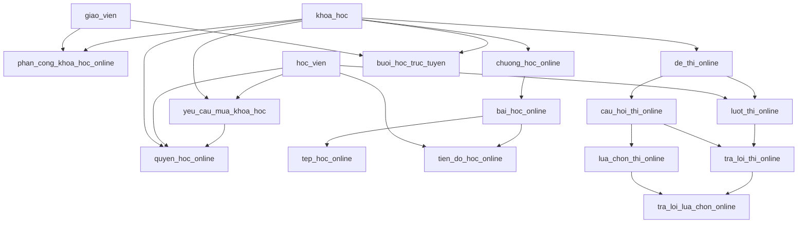

# Đặc tả bổ sung chức năng học trực tuyến

Ngày tổng hợp: 04/11/2026.

Tài liệu tổng hợp phạm vi đã trao đổi và đề xuất thiết kế dữ liệu cho hệ thống hiện tại. Đây là bản thiết kế; chưa thay đổi mã nguồn hay cơ sở dữ liệu. Tên cột chi tiết và migration sẽ được hoàn thiện khi triển khai.

## 1. Mô hình khóa học và mua khóa học

Một khóa học có thể bán theo hình thức trực tiếp, online hoặc cả hai. Mỗi lượt mua chọn đúng một hình thức và lưu học phí tại thời điểm mua.

| Nội dung | Trực tiếp | Online |
|---|---|---|
| Sau khi xác nhận thanh toán | Đăng ký/phân lớp như hiện tại | Cấp quyền học online |
| Lớp, phòng, lịch học và sĩ số | Theo chức năng hiện có | Không bắt buộc, không tạo lớp giả |
| Nội dung học | Theo lớp hiện tại | Video, tài liệu, bài thi và lịch học qua Zoom/Meet |
| Quyền truy cập | Theo đăng ký lớp | Theo quyền học online còn hiệu lực |

Luồng mua:

```text
Chọn khóa học → chọn hình thức → hiển thị giá → gửi yêu cầu mua
    → chờ xác nhận thanh toán
        ├── Trực tiếp: đăng ký lớp, cập nhật sĩ số như hiện tại
        └── Online: cấp quyền học, mở nội dung và thông tin học trực tuyến
```

- Không cấp quyền chỉ vì học viên đã gửi yêu cầu mua.
- Đơn bị từ chối không tạo đăng ký hoặc quyền học.
- Có thể mua cùng khóa học theo hai hình thức khác nhau; kiểm tra trùng mua phải xét cả hình thức.
- Thời hạn học online có thể không giới hạn hoặc có ngày hết hạn. Đây là cấu hình cần chốt khi triển khai.
- Giai đoạn đầu: tài liệu cho phép tải; video xem online. Có thể bổ sung cấu hình cho phép tải video nếu cần.

## 2. Chức năng theo vai trò

### 2.1. Học viên

- Xem khóa học, lựa chọn online hoặc trực tiếp và học phí tương ứng.
- Gửi yêu cầu mua và theo dõi trạng thái xử lý.
- Xem danh sách “Khóa học của tôi”.
- Với khóa online đã kích hoạt: xem chương, bài học, phát video, tải tài liệu.
- Xem tiến độ và đánh dấu hoàn thành bài học.
- Làm thi thử trắc nghiệm, đọc, viết và nói.
- Xem lịch sử làm bài, điểm và nhận xét theo quy định công bố kết quả.
- Xem tab “Thông tin học trực tuyến” của khóa đã mua.
- Mở liên kết tham gia Zoom, Google Meet hoặc nền tảng khác.

### 2.2. Giảng viên

- Tạo khóa học online ở trạng thái bản nháp, nhập mô tả và nội dung đề xuất; admin duyệt thông tin bán và học phí trước khi mở bán.
- Quản lý nội dung các khóa được phân công, kể cả khóa do mình tạo.
- Tạo, sửa, sắp xếp chương và bài học; lưu nháp và xuất bản.
- Upload video, tài liệu đính kèm, đặt tên và mô tả tài liệu.
- Tạo đề thi, câu hỏi, lựa chọn, đáp án và tiêu chí chấm.
- Xem bài nộp; chấm nói, viết và các câu tự luận đọc hiểu; gửi nhận xét.
- Tạo, sửa, hủy thông báo buổi học trực tuyến.
- Theo dõi tiến độ và kết quả của học viên thuộc khóa phụ trách.

### 2.3. Admin/nhân viên

- Admin quản lý hình thức bán, học phí, duyệt khóa học và phân công giảng viên.
- Admin/nhân viên được phân quyền xác nhận hoặc từ chối yêu cầu mua.
- Theo dõi hóa đơn, thanh toán và quyền học online.
- Admin xử lý thu hồi/gia hạn quyền học theo chính sách; thay đổi quyền không tự đồng nghĩa hoàn tiền.
- Admin quản lý nội dung, đề thi và lịch trực tuyến khi cần.

## 3. Cấu trúc nội dung và bài thi

```text
Khóa học online
├── Chương
│   └── Bài học
│       ├── Nội dung mô tả
│       ├── Video
│       └── Tài liệu tải về
├── Thi thử
│   ├── Trắc nghiệm
│   ├── Đọc
│   ├── Viết
│   └── Nói
└── Thông tin học trực tuyến
    └── Các buổi học và liên kết tham gia
```

| Loại thi | Hình thức trả lời | Cách chấm ban đầu |
|---|---|---|
| Trắc nghiệm | Chọn một/nhiều đáp án | Backend tự chấm |
| Đọc | Đọc đoạn văn, chọn đáp án, điền từ hoặc tự luận | Tự chấm đáp án cố định; giảng viên chấm tự luận |
| Viết | Nhập bài viết theo đề | Giảng viên chấm theo tiêu chí, nhận xét |
| Nói | Ghi âm hoặc upload âm thanh | Giảng viên nghe và chấm theo tiêu chí |

- Mỗi đề cấu hình thời gian, số lần thi tối đa và thời điểm công bố đáp án/kết quả.
- Lưu nháp câu trả lời và lịch sử từng lần làm bài.
- Backend kiểm tra hạn nộp và quyền làm bài; không dựa riêng vào đồng hồ giao diện.
- Đáp án đúng, lời giải và điểm chưa công bố không trả về cho học viên đang làm bài.
- Đề đã có lượt thi cần giữ nguyên phiên bản; chỉnh sửa nội dung bằng phiên bản/bản sao mới để bảo toàn lịch sử.
- Chấm nói/viết bằng AI chưa nằm trong phạm vi triển khai ban đầu.

## 4. Tab “Thông tin học trực tuyến”

Mỗi thông báo buổi học gồm:

| Thông tin | Ví dụ |
|---|---|
| Tiêu đề | Luyện Speaking – Buổi 3 |
| Khóa học | IELTS Foundation Online |
| Giảng viên | Giảng viên được phân công |
| Bắt đầu/kết thúc | 10/11/2026, 19:00–20:30, giờ Việt Nam |
| Nền tảng | Zoom / Google Meet / Khác |
| Link tham gia | Liên kết do giảng viên cung cấp |
| Mã phòng/mật khẩu | Nếu nền tảng yêu cầu |
| Nội dung, chuẩn bị | Đọc trước tài liệu Speaking Part 1 |
| Trạng thái | Đã lên lịch / Đã hủy; sắp diễn ra, đang diễn ra, đã kết thúc suy ra theo thời gian |

- Chỉ học viên có quyền online còn hiệu lực của khóa và người có quyền quản lý mới xem được thông tin, link phòng.
- Giảng viên chỉ tạo/sửa/hủy buổi học trong khóa được phân công.
- Khi đổi lịch hoặc link, tab hiển thị thông tin mới và thời điểm cập nhật.
- Giai đoạn đầu giảng viên tạo phòng bên ngoài rồi dán link; hệ thống không tự tạo phòng Zoom/Meet.
- Tab là nơi công bố thông tin. Email, push notification, nhắc lịch tự động là phần mở rộng, chưa mặc định có trong phạm vi này.
- Lưu thời gian nhất quán ở backend, hiển thị theo múi giờ `Asia/Ho_Chi_Minh`.

## 5. Các bảng hiện có cần chỉnh sửa

### 5.1. `khoa_hoc`

Giữ danh mục hiện có, bổ sung:

| Cột đề xuất | Ý nghĩa |
|---|---|
| `hinh_thuc_ban` | `truc_tiep`, `online`, `ca_hai` |
| `hoc_phi_online` | Giá online; giữ `hoc_phi` hiện có làm giá trực tiếp |
| `thoi_han_online_ngay` | Số ngày truy cập; NULL là không giới hạn |
| `trang_thai_duyet` | Bản nháp, chờ duyệt, đã duyệt, từ chối |
| `ma_nguoi_tao` | Người tạo khóa học, tham chiếu `nguoi_dung` |

Giữ `trang_thai` hiện tại để điều khiển mở/ngừng bán; chỉ cho mở bán khóa đã được duyệt. Khóa cũ chuyển mặc định sang hình thức trực tiếp và đã duyệt.

### 5.2. `yeu_cau_mua_khoa_hoc`

| Thay đổi | Ý nghĩa |
|---|---|
| Thêm `hinh_thuc_hoc` | `truc_tiep` hoặc `online`; dữ liệu cũ mặc định trực tiếp |
| Cho `ma_lop_hoc` NULL | Đơn online không cần lớp; đơn trực tiếp vẫn bắt buộc lớp hợp lệ |
| Giữ `so_tien` | Chụp giá tại thời điểm mua, không tính lại theo giá hiện tại lúc duyệt |

Cần cập nhật kiểm tra đầu vào, chống trùng và truy vấn danh sách. Hiện truy vấn dùng `JOIN lop_hoc`, phải chuyển phù hợp sang `LEFT JOIN` để đơn online không bị mất khỏi danh sách.

### 5.3. `hoa_don` và `thanh_toan`

- Dùng lại hệ thống hóa đơn, thanh toán hiện có; không tạo bảng thanh toán online riêng.
- Đề xuất thêm loại hóa đơn `hoc_phi_online`: `ma_tham_chieu` của loại này trỏ tới quyền học online. Loại `hoc_phi` hiện tại tiếp tục trỏ tới đăng ký lớp.
- Cập nhật các báo cáo doanh thu/học phí để tính cả hai loại; không giả định mọi hóa đơn học phí đều liên kết lớp.
- Việc duyệt yêu cầu, tạo quyền/đăng ký, hóa đơn, thanh toán và cập nhật trạng thái yêu cầu phải cùng transaction, chống xử lý lặp.

### 5.4. Các bảng giữ luồng hiện tại

`lop_hoc`, `dang_ky_hoc`, `khung_gio_hoc`, `buoi_hoc`, `phong_hoc`, `diem_danh` tiếp tục phục vụ lớp trực tiếp. Không dùng chúng để tạo lớp giả cho khóa online.

## 6. Các bảng mới đề xuất

Các bảng dùng khóa chính INT tương thích với schema hiện tại. FK là khóa ngoại; các trường trạng thái cần giới hạn tập giá trị khi triển khai.

### 6.1. `phan_cong_khoa_hoc_online` — giảng viên phụ trách

- `ma_phan_cong` (PK).
- `ma_khoa_hoc` (FK → `khoa_hoc`).
- `ma_giao_vien` (FK → `giao_vien`).
- `ngay_phan_cong`, `trang_thai` (đang phụ trách/ngừng phụ trách).
- UNIQUE (`ma_khoa_hoc`, `ma_giao_vien`); một khóa có thể có nhiều giảng viên.

### 6.2. `quyen_hoc_online` — quyền truy cập của học viên

- `ma_quyen_hoc` (PK).
- `ma_hoc_vien` (FK → `hoc_vien`).
- `ma_khoa_hoc` (FK → `khoa_hoc`).
- `ma_yeu_cau` (FK → `yeu_cau_mua_khoa_hoc`, UNIQUE để tránh cấp trùng từ cùng đơn).
- `ngay_kich_hoat`, `ngay_het_han` (NULL nếu không giới hạn).
- `trang_thai` (hoạt động/thu hồi), `ly_do_thu_hoi`, `ngay_thu_hoi`.
- Hết hạn được xác định từ thời gian, không chỉ từ trạng thái lưu trong bảng.
- Index (`ma_hoc_vien`, `ma_khoa_hoc`, `trang_thai`); cho phép lưu lịch sử các lần mua/gia hạn theo chính sách, đồng thời chống mua trùng quyền còn hiệu lực trong transaction.

### 6.3. `chuong_hoc_online` — chương

- `ma_chuong` (PK), `ma_khoa_hoc` (FK).
- `ten_chuong`, `mo_ta`, `thu_tu`.
- `trang_thai` (nháp/đã xuất bản/ẩn), `ngay_tao`, `ngay_cap_nhat`.

### 6.4. `bai_hoc_online` — bài học

- `ma_bai_hoc` (PK), `ma_chuong` (FK).
- `tieu_de`, `noi_dung`, `thu_tu`, `thoi_luong_giay`.
- `trang_thai` (nháp/đã xuất bản/ẩn).
- `ma_nguoi_tao` (FK → `nguoi_dung`), `ngay_tao`, `ngay_cap_nhat`.

### 6.5. `tep_hoc_online` — video, tài liệu và file bài nói

- `ma_tep` (PK).
- `ma_bai_hoc` (FK, NULL với file bài nói; file này được câu trả lời tham chiếu).
- `ma_nguoi_tai_len` (FK → `nguoi_dung`).
- `loai_tep` (video/tài liệu/bài nói), `ten_goc`, `khoa_luu_tru`, `mime_type`, `dung_luong_byte`.
- `cho_phep_tai`, `thu_tu`, `trang_thai_xu_ly`, `ngay_tao`.
- Chỉ lưu metadata và khóa lưu trữ, không lưu toàn bộ file trong MySQL.
- Quyền truy cập phụ thuộc bài học/khóa học hoặc bài nộp liên quan, không dựa vào việc đoán được mã file.

### 6.6. `tien_do_hoc_online` — tiến độ

- `ma_tien_do` (PK), `ma_hoc_vien` (FK), `ma_bai_hoc` (FK).
- `vi_tri_video_giay`, `da_hoan_thanh`, `ngay_hoan_thanh`, `lan_truy_cap_cuoi`.
- UNIQUE (`ma_hoc_vien`, `ma_bai_hoc`).
- Đánh dấu hoàn thành là phục vụ theo dõi học tập; không mặc định chứng minh đã xem toàn bộ video.

### 6.7. `de_thi_online` — đề thi thử

- `ma_de_thi` (PK), `ma_khoa_hoc` (FK), `ma_bai_hoc` (FK, NULL nếu thi cấp khóa).
- `tieu_de`, `huong_dan`, `loai_de` (trắc nghiệm/đọc/viết/nói/tổng hợp).
- `thoi_gian_phut`, `so_lan_thi_toi_da`, `diem_dat`, `quy_dinh_cong_bo_ket_qua`.
- `phien_ban`, `trang_thai`, `ma_nguoi_tao` (FK → `nguoi_dung`), `ngay_tao`.
- Nếu gắn bài học, phải xác nhận bài học thuộc cùng khóa.

### 6.8. `cau_hoi_thi_online` — câu hỏi

- `ma_cau_hoi` (PK), `ma_de_thi` (FK).
- `loai_cau_hoi` (một đáp án/nhiều đáp án/điền từ/tự luận/bài nói).
- `doan_doc`, `noi_dung`, `thu_tu`, `diem_toi_da`.
- `dap_an_mau`, `tieu_chi_cham`, `giai_thich`.
- Với điền từ, đáp án mẫu có thể dùng JSON chứa các đáp án chấp nhận và quy tắc chuẩn hóa. Không dùng đáp án mẫu văn bản để tự chấm bài viết/nói.

### 6.9. `lua_chon_thi_online` — lựa chọn trắc nghiệm

- `ma_lua_chon` (PK), `ma_cau_hoi` (FK).
- `noi_dung`, `la_dap_an_dung`, `thu_tu`.
- Câu một đáp án phải có đúng một lựa chọn đúng; câu nhiều đáp án có thể có nhiều lựa chọn đúng.

### 6.10. `luot_thi_online` — mỗi lần làm bài

- `ma_luot_thi` (PK), `ma_de_thi` (FK), `ma_hoc_vien` (FK).
- `lan_thi`, `bat_dau_luc`, `han_nop_luc`, `nop_luc`.
- `trang_thai` (đang làm/đã nộp/chờ chấm/đã chấm).
- `tong_diem`, `nhan_xet_chung`, `cong_bo_luc`.
- UNIQUE (`ma_de_thi`, `ma_hoc_vien`, `lan_thi`); cấp số lần thi và kiểm tra giới hạn trong transaction.

### 6.11. `tra_loi_thi_online` — câu trả lời và chấm điểm

- `ma_tra_loi` (PK), `ma_luot_thi` (FK), `ma_cau_hoi` (FK).
- `noi_dung_tra_loi` cho điền từ/viết; `ma_tep_bai_noi` (FK → `tep_hoc_online`, NULL nếu không dùng).
- `diem`, `nhan_xet`, `ma_nguoi_cham` (FK → `nguoi_dung`, NULL khi tự chấm), `cham_luc`, `cap_nhat_luc`.
- UNIQUE (`ma_luot_thi`, `ma_cau_hoi`).
- Câu hỏi phải thuộc đề của lượt thi; file bài nói phải thuộc người nộp và đúng loại.

### 6.12. `tra_loi_lua_chon_online` — đáp án học viên chọn

- `ma_tra_loi` (FK → `tra_loi_thi_online`).
- `ma_lua_chon` (FK → `lua_chon_thi_online`).
- PK (`ma_tra_loi`, `ma_lua_chon`).
- Hỗ trợ cả một và nhiều đáp án; xác nhận lựa chọn thuộc đúng câu hỏi. Quy tắc tính điểm câu nhiều đáp án phải được xác định trước, giai đoạn đầu có thể chọn đúng toàn bộ mới nhận điểm.

### 6.13. `buoi_hoc_truc_tuyen` — lịch và thông tin tham gia

- `ma_buoi_online` (PK), `ma_khoa_hoc` (FK), `ma_giao_vien` (FK).
- `tieu_de`, `noi_dung`, `yeu_cau_chuan_bi`.
- `bat_dau_luc`, `ket_thuc_luc`, `nen_tang` (Zoom/Google Meet/khác), `ten_nen_tang_khac`.
- `link_tham_gia`, `ma_phong`, `mat_khau_phong` (các trường tùy chọn theo nền tảng).
- `trang_thai` (đã lên lịch/đã hủy), `ly_do_huy`, `ngay_tao`, `ngay_cap_nhat`.
- Index (`ma_khoa_hoc`, `bat_dau_luc`); kết thúc phải sau bắt đầu.
- Giảng viên phải đang được phân công khóa học tại thời điểm tạo/sửa; không xóa lịch sử buổi học chỉ vì thay đổi phân công.

## 7. Quan hệ dữ liệu chính



## 8. Quy tắc backend và lưu trữ

- Lấy danh tính học viên/giảng viên từ JWT; không tin mã người dùng do client tự gửi để quyết định quyền.
- Kiểm tra quyền ở mọi API: nội dung, file, link phòng, lượt thi, kết quả và chấm bài.
- Học viên chỉ xem nội dung đã xuất bản khi còn quyền học. Việc ẩn chương phải ẩn cả các bài bên trong.
- Giảng viên chỉ sửa nội dung và chấm bài trong khóa được phân công.
- Xử lý xác nhận thanh toán bằng transaction và khóa bản ghi yêu cầu; gửi lại thao tác không tạo trùng quyền/hóa đơn/thanh toán.
- Cần quy định khi thu hồi/hết hạn trong lúc thi; đề xuất chặn lượt thi mới và kiểm tra quyền khi nộp, đồng thời giữ bài nháp và lịch sử.
- Lưu file ngoài thư mục public. Giai đoạn đồ án có thể dùng thư mục riêng trên backend; khi triển khai có thể dùng object storage.
- Upload kiểm tra loại file thực tế, dung lượng, quyền người tải và tên file; tên lưu trữ do server tạo.
- Video hỗ trợ tua và tải từng phần; tài liệu tải qua API có xác thực hoặc đường dẫn có thời hạn.
- File ghi âm chỉ người nộp và người có quyền chấm/quản lý được truy cập.
- Không xóa dây chuyền dữ liệu thanh toán, quyền học, đề đã thi và kết quả; ưu tiên ẩn/lưu trữ để giữ lịch sử.
- Link phòng chỉ hiện cho người đủ quyền, nhưng người đã xem vẫn có thể chia sẻ; mật khẩu/phòng chờ của Zoom/Meet hỗ trợ quản lý người tham dự.

## 9. Màn hình cần bổ sung/chỉnh sửa

| Vai trò | Màn hình |
|---|---|
| Học viên | Chi tiết khóa và chọn hình thức mua; trạng thái yêu cầu mua |
| Học viên | Khóa học của tôi; xem video, chương/bài, tài liệu, tiến độ |
| Học viên | Danh sách thi thử; làm bài; ghi âm/upload; lịch sử và kết quả |
| Học viên | Tab Thông tin học trực tuyến và nút tham gia |
| Giảng viên | Tạo khóa nháp; danh sách khóa phụ trách; quản lý chương/bài và upload |
| Giảng viên | Quản lý đề/câu hỏi; danh sách bài nộp; chấm và nhận xét |
| Giảng viên | Quản lý lịch trực tuyến, nền tảng và link phòng |
| Admin | Cấu hình hình thức/giá; duyệt khóa; phân công giảng viên |
| Admin/nhân viên | Danh sách yêu cầu mua có phân loại; duyệt theo từng hình thức |
| Admin | Quản lý quyền online và báo cáo doanh thu bao gồm online |

Các giao diện học viên/giảng viên cần tích hợp vào ứng dụng đang sử dụng thực tế; phần quản trị cập nhật tại `FE/Admin`. Backend dùng chung, không tạo quyền riêng cho từng giao diện.

## 10. Lộ trình và tiêu chí nghiệm thu

### Giai đoạn 1: Mua online và học bằng nội dung

- Migration hình thức bán/mua, phân công giảng viên, quyền học, chương/bài, file và tiến độ.
- Duyệt đơn online mở quyền mà không tạo lớp hoặc thay đổi sĩ số.
- Đơn trực tiếp vẫn đi theo luồng hiện tại.
- Học viên đúng quyền xem được video/tải tài liệu; người chưa mua không truy cập được qua API hoặc link file trực tiếp.
- Duyệt lại cùng một yêu cầu không tạo bản ghi tài chính/quyền trùng.

### Giai đoạn 2: Thông tin học trực tuyến

- Giảng viên phụ trách tạo/sửa/hủy lịch Zoom/Meet.
- Học viên có quyền xem đúng lịch của khóa; đổi lịch hiển thị ngay khi tải lại dữ liệu.
- Giảng viên ngoài khóa và học viên không có quyền bị từ chối truy cập.

### Giai đoạn 3: Thi thử

- Trắc nghiệm/đọc: tạo đề, làm bài, tự chấm và xem kết quả theo cấu hình.
- Viết/nói: lưu bài, upload âm thanh, chờ giảng viên chấm và nhận xét.
- Kiểm tra giới hạn thời gian/lượt thi, chống nộp lặp, giữ phiên bản đề và không lộ đáp án trước thời điểm cho phép.

### Phần mở rộng sau

- Email/push nhắc lịch và thông báo đổi lịch.
- Tự tạo phòng Zoom/Meet qua API.
- Chấm nói/viết bằng AI, chứng chỉ, thống kê học tập nâng cao.
- Hoàn tiền tự động và quy trình chuyển đổi hình thức học nếu có yêu cầu nghiệp vụ.

## 11. Tổng hợp phạm vi dữ liệu

- **13 bảng mới đề xuất**: phân công, quyền học, chương, bài học, file, tiến độ, đề, câu hỏi, lựa chọn, lượt thi, câu trả lời, lựa chọn đã trả lời và buổi học trực tuyến.
- **3 bảng cần chỉnh schema chính**: `khoa_hoc`, `yeu_cau_mua_khoa_hoc`, `hoa_don`.
- Dùng lại `thanh_toan`, `hoc_vien`, `giao_vien`, `nguoi_dung`; cập nhật nghiệp vụ và báo cáo liên quan.
- Không thay thế cơ chế phân lớp trực tiếp đang có.
